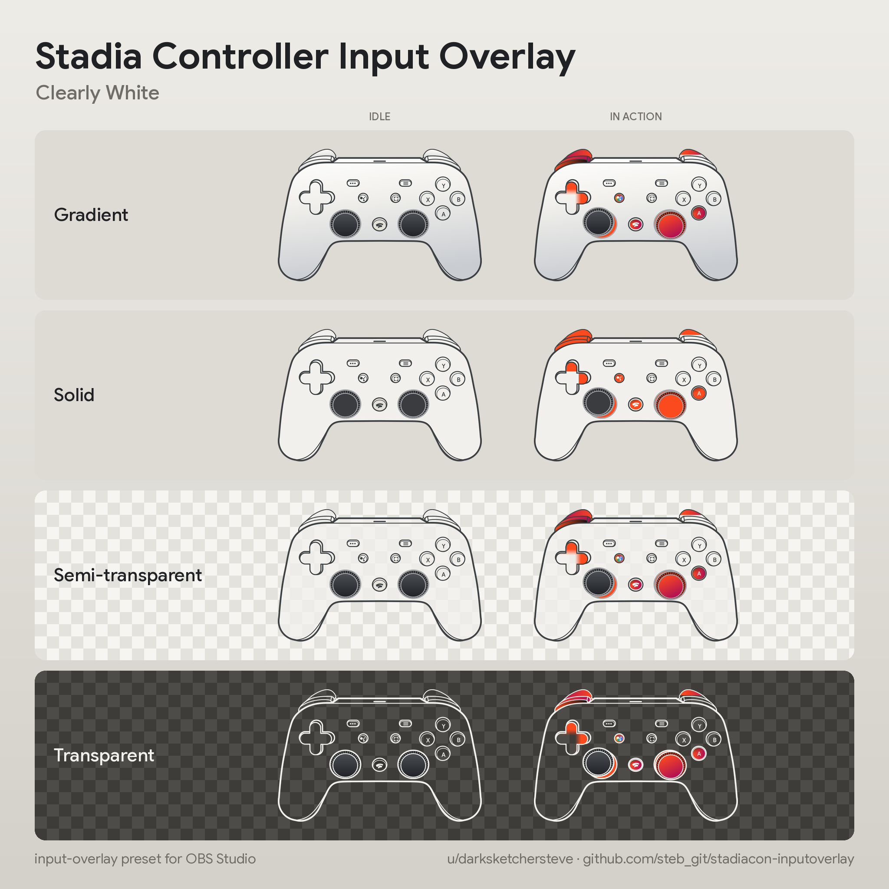
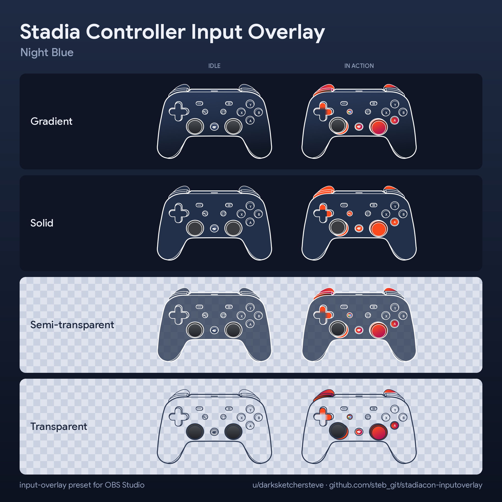
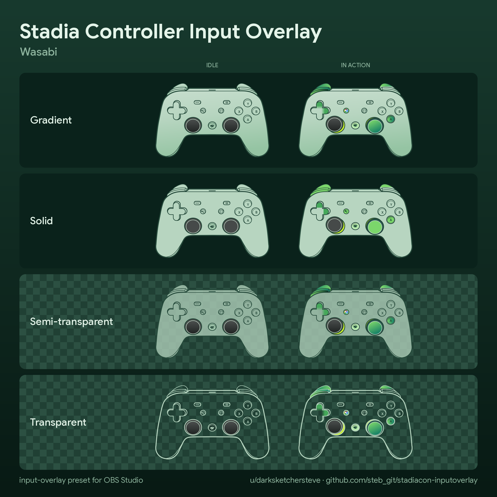
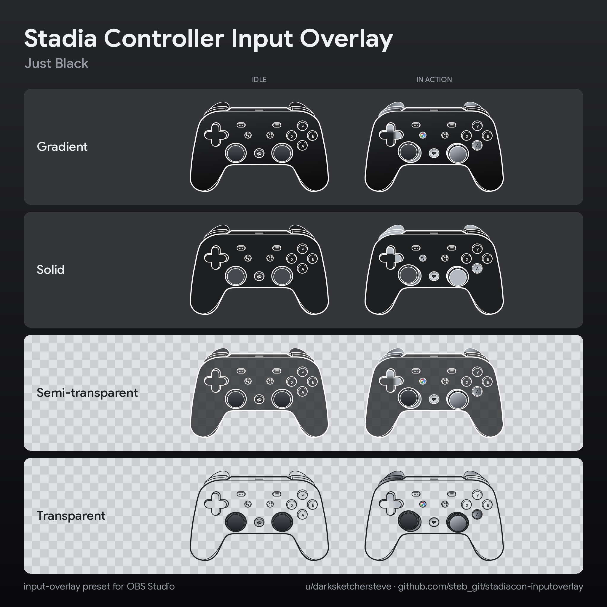
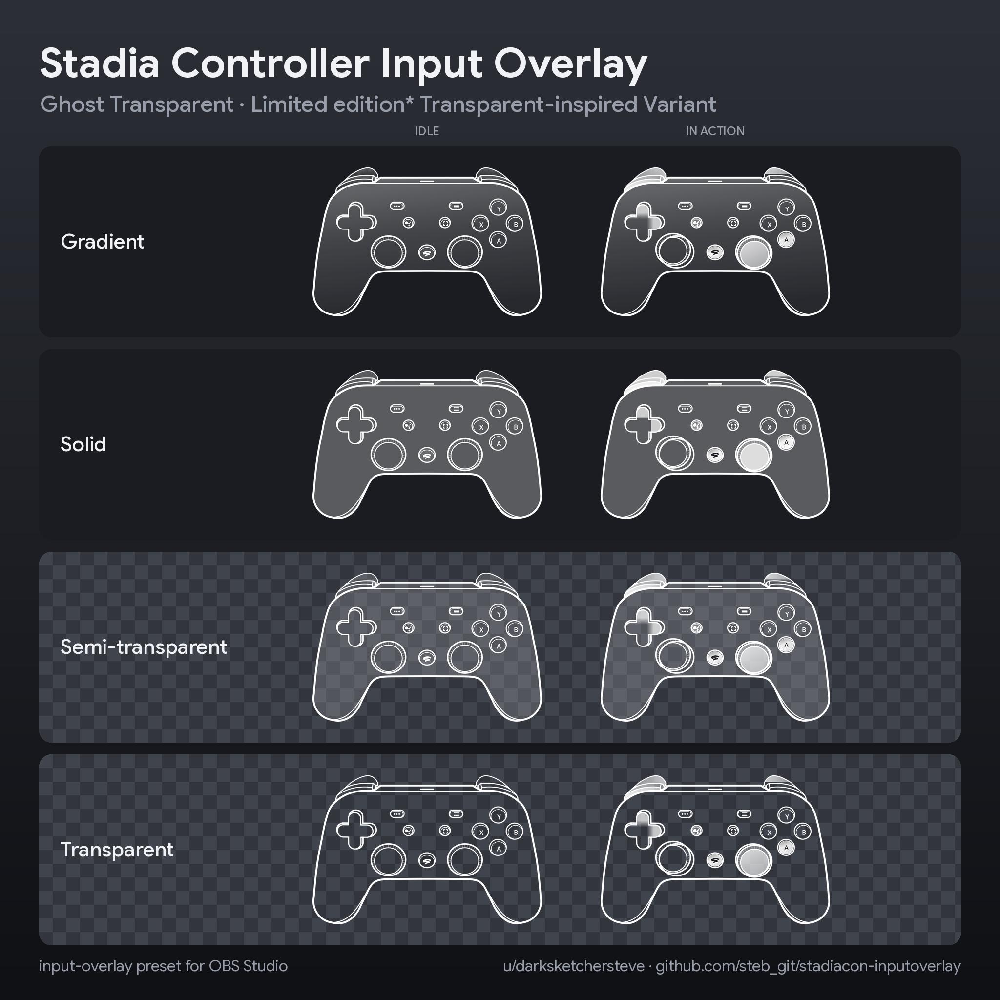

<h1 align=center>Stadia Controller - Input Overlay Preset</h1>

A controller preset, modelled after the _most ergonomic*_ Stadia controller, for use with the <a href=https://github.com/univrsal/input-overlay>Input Overlay plugin by univrsal</a> on OBS Studio.

(Requires Input Overlay v5.0, OBS Studio 30 or newer in order for it to work.)

_Created with inkscape._

Rep your Stadia controller, LIVE with this preset! 

Each of the buttons respond with your presses through colorful, caved-in buttons, a _semi_-lifelike perspective of the controller pad, with many variants and colorways to choose from, mirroring your actual Stadia controller color!

## So, what's inside?

This preset pack features different colorways of the Stadia controller that has ever been released, to match and rep what you own, on stream!:
- Clearly White
- Night Blue (Founders' edition)
- Wasabi
- Just Black
- Limited edition Ghost transparent (* _not exactly sold, but was given away to people who had worked on the controller_)

Each of these colorways have different hand-crafted variants to choose from, depending on your style:
- Gradiented
- Solid
- Semi-transparent
- Transparent (only the outline shows)

## How to use

If you have not yet installed Input Overlay, refer to the <a href="https://github.com/univrsal/input-overlay/wiki/Installation">plugin's installation guide here.</a>

However, if you already have the plugin installed, here's how to get the preset working on OBS Studio:

1. **Download** the preset from <a href="https://github.com/steb-git/stadiacon-inputoverlay/releases">the releases page</a>
2. **Extract** the preset's contents anywhere accessible (though, I recommend putting it inside <code>C:\ProgramData\obs-studio\plugins</code> for better access)
3. Once extracted, add "Input Overlay" as a new source in your OBS Studio dashboard.
4. Right click it, and head over to **properties**.
5. For the **Overlay Image File**, choose one of the variants inside the extracted folder (the ones under the .PNG format); thus, for the **Overlay config file**, select the included configuration file named <code>stadia-controller.json</code> so it won't look crazed out.

_(NOTE: make sure your stadia controller is detected and connected!)_

When done right, it should look like this:

</img>

6. Confirm that the preset is responding with button presses and stick movements, and freely position your new Stadia controller-styled input overlay!

<h2>Sample Gallery (click to collapse)</h2>

<table>
  <tr>
    <th>Variant</th>
    <th>Preview</th>
  </tr>
  <tr>
    <td align="center">Clearly White</td>
    <td align="center"></td>
  </tr>
  <tr>
    <td align="center">Night Blue</td>
    <td align="center"></td>
  </tr>
  <tr>
    <td align="center">Wasabi</td>
    <td align="center"></td>
  </tr>
  <tr>
    <td align="center">Just Black</td>
    <td align="center"></td>
  </tr>
  <tr>
    <td align="center">Ghost transparent</td>
    <td align="center"></td>
  </tr>
</table>

## For developers:

**Great news!** aside from using this preset as an input overlay appearance, you can freely use **any** of the PNG texture files (Including the respective SVG source file) for your own personal projects! 

As this is already one of the most defined textures for the Stadia controller out there, you can easily integrate these on your workflows, especially if you're making a button mapper project of some sort.

## License and Legal

This project is vetted under the Creative Commons CC0 1.0 Universal license, which means that the assets are now under the **public domain**, allowing you to use all of these on any of your personal projects, and commercial streams.

_**AI Usage disclosure:** Claude AI has been used for automating ONLY for error-checking (making sure the icons are properly arranged, and the creation of the <code>stadia-controller.json</code> preset file. Human authoring is placed at the highest precedence of the project, whereas the textures are hand-traced using Inkscape, thus further minor pixel-level alignment were done with Claude._ 

_Stadia, the Stadia logo, the Stadia controller design, Google and the Google Assistant are trademarks of Google LLC. This is an unofficial, fan-made project and is not affiliated with, sponsored by or endorsed by Google LLC. The licenses above cover only the original artwork and configuration in this repository and grant no rights to Google's trademarks._
